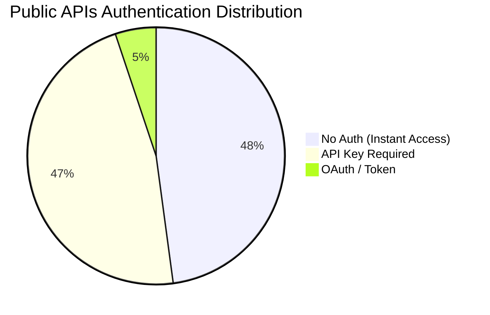

# GitHub Public-APIs Catalog & Integration Hub

A comprehensive local catalog of **2,047 public APIs** parsed from the GitHub repository [`public-apis/public-apis`](https://github.com/public-apis/public-apis), indexed with SQLite FTS5 full-text search, and organized into curated collections for immediate use across your workspace.

---

## 📊 Catalog Overview & Metrics



- **Total Public APIs**: 2,047
- **Distinct Categories**: 52
- **Zero Authentication (Drop-in Ready)**: 980 (47.9%)
- **HTTPS Supported**: 1,949 (95.2%)
- **CORS Enabled**: 789 (38.5%)

---

## 💾 Local Storage & Assets

All files are stored in [`c:\Antigravity\public-apis`](file:///c:/Antigravity/public-apis):

| Asset | Location | Size / Format | Description |
|:---|:---|:---|:---|
| **SQLite FTS5 DB** | [`public_apis.db`](file:///c:/Antigravity/public-apis/public_apis.db) | ~1.4 MB | Indexed SQLite database with FTS5 full-text search across all fields. |
| **Complete JSON** | [`public_apis.json`](file:///c:/Antigravity/public-apis/public_apis.json) | ~800 KB | Full structured JSON dataset with tags and metadata. |
| **Flat CSV** | [`public_apis.csv`](file:///c:/Antigravity/public-apis/public_apis.csv) | ~400 KB | Tabular format for Excel / Pandas / analysis. |
| **Curated Collections** | [`curated_useful_apis.json`](file:///c:/Antigravity/public-apis/curated_useful_apis.json) | ~25 KB | Filtered subsets for Finance, Photos, ML, and Free APIs. |
| **CLI & Query Tool** | [`api_hub.py`](file:///c:/Antigravity/public-apis/api_hub.py) | Python CLI | Search, ping, filter, and generate code snippets. |
| **Live Demo Script** | [`demo_usage.py`](file:///c:/Antigravity/public-apis/demo_usage.py) | Python | Verification script calling live public endpoints. |
| **Ingestion Pipeline** | [`ingest_and_index.py`](file:///c:/Antigravity/public-apis/ingest_and_index.py) | Python | Upstream fetch & re-index pipeline. |

---

## 🎯 Curated APIs for Workspace Projects

Based on your active projects in `c:\Antigravity`, here are top recommended public APIs:

### 1. Finance, Markets & Trading
*(For `TradingBot`, `autonomous-trading-cockpit`, `daily_stock_analysis`, `sotck_predict`, `stock-signal-scanner`)*

| API | Auth | CORS | Best For | Endpoint / Docs |
|:---|:---|:---|:---|:---|
| **CoinGecko** | No | Yes | Live crypto prices, volume, market caps | `https://api.coingecko.com/api/v3` |
| **Frankfurter** | No | Yes | Currency exchange rates & historical forex | `https://api.frankfurter.app/` |
| **FRED** | apiKey | Yes | Federal Reserve economic data, interest rates | `https://fred.stlouisfed.org/docs/api/fred/` |
| **SEC EDGAR** | No | Yes | Corporate filings, 10-K, 10-Q, insider transactions | `https://www.sec.gov/edgar/sec-api-documentation` |
| **Polygon.io** | apiKey | No | US stocks, equities, options tick data | `https://polygon.io/` |
| **Finnhub** | apiKey | Yes | Global stock fundamentals, sentiment, news | `https://finnhub.io/` |

### 2. Photos & Visual Media
*(For `PhotoCollage`, `PhotoSort`, `PhotoStudio`)*

| API | Auth | CORS | Best For | Endpoint / Docs |
|:---|:---|:---|:---|:---|
| **Lorem Picsum** | No | Yes | High-res image generation & placeholder metadata | `https://picsum.photos/` |
| **Unsplash** | apiKey | Yes | High quality curated photo library | `https://unsplash.com/developers` |
| **ReSmush.it** | No | Yes | Lossless & lossy image compression | `https://resmush.it/api` |
| **Cloudinary** | apiKey | Yes | Automated resizing, cropping, and smart face detection | `https://cloudinary.com/documentation` |
| **Robohash** | No | Yes | Generative avatars and unique graphic placeholders | `https://robohash.org/` |

### 3. AI, NLP & Machine Learning
*(For model testing and text/data enrichment)*

| API | Auth | CORS | Best For | Endpoint / Docs |
|:---|:---|:---|:---|:---|
| **Hugging Face** | apiKey | Yes | Serverless inference on open-source LLMs & vision models | `https://huggingface.co/docs/api-inference` |
| **Sentiment Analysis** | No / Key | Yes | Polarity scoring for stock news / social feeds | Category: `Text Analysis` |
| **OCR.Space** | apiKey | Yes | Extract text and metadata from photo uploads | `https://ocr.space/ocrapi` |

---

## 🛠️ How to Search & Use

### Quick Command-Line Queries
```bash
# Full text search for stock APIs
python c:\Antigravity\public-apis\api_hub.py search "stock"

# Filter for zero-authentication free APIs
python c:\Antigravity\public-apis\api_hub.py search "photo" --free

# View curated finance endpoints
python c:\Antigravity\public-apis\api_hub.py curated finance

# Test an API endpoint live
python c:\Antigravity\public-apis\api_hub.py test "CoinGecko"

# Generate code snippet
python c:\Antigravity\public-apis\api_hub.py snippet "Polygon"
```

### Direct Python Integration
```python
import sqlite3

conn = sqlite3.connect(r"C:\Antigravity\public-apis\public_apis.db")
conn.row_factory = sqlite3.Row
cur = conn.cursor()

# Fast full-text search
cur.execute("""
    SELECT a.name, a.url, a.auth, a.description
    FROM apis a
    JOIN apis_fts f ON a.id = f.rowid
    WHERE apis_fts MATCH 'stock' AND a.auth = 'No'
""")
for row in cur.fetchall():
    print(row['name'], row['url'])
conn.close()
```
